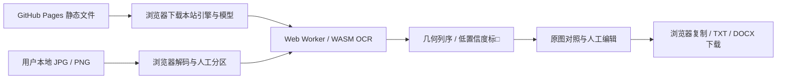

# 纯前端技术方案

## 架构

使用原生 HTML/CSS/JavaScript + Vite 静态构建，Tesseract.js 7 在浏览器 Web Worker / WebAssembly 执行识别，docx 9 在浏览器生成 Word。生产网站由 GitHub Pages 提供静态文件，没有 Python、数据库、识别 API 或服务器端导出。

## 引擎的实际支持程度

| 内容 | 当前支持 | 实际限制 |
| --- | --- | --- |
| 繁体横排 | chi_tra 模型，真实浏览器已执行 | 模型误识和漏字仍存在 |
| 繁体竖排 | chi_tra_vert + PSM 5，检测列按右至左、列内上至下排序 | 不是专门清代模型，字体/残损影响明显 |
| 异体字与罕见字 | 不做简繁转换；已识别和手动输入的 Unicode 原样保存/导出 | OCR 字集和字形识别不覆盖所有异体/俗字，不能保证原字形 |
| 小字双行、夹注、版心 | 可人工框选并标为独立栏目 | 没有可靠自动古籍版面分类；检测或列序可能错 |
| 无法确认字 | 检测字词低于阈值逐码位替换为□，并标原图位置 | 置信度不等于正确率，漏检/高置信度误识无法全部标疑 |
| 标点与原文 | 不加入标点补全、润色、语义断句、上下文补字 | OCR 自身仍可能增、漏、误识，包括标点 |

本次浏览器实测 default SIMD 核心与该浮点繁体模型不兼容，报 DotProductSSE 缺失函数。当前明确使用经实测通过的**非 SIMD LSTM WASM 核心**，没有通过换成猜测结果或关闭模型校验来规避故障。性能以本机实测为准，未来更换核心/模型须重新评测。

Tesseract.js 的 WASM 接口提供不带 CLI 表头的 TSV，解析同时支持两种格式。模型旧参数会在浏览器控制台出现部分未识别参数提示；本次实际识别仍完成。这些提示及支持程度不能用构建成功代替精度验证。

此选择满足免费、无需 API Key、浏览器 CPU 运行及 Pages 部署。未测试其他浏览器深度 OCR/WebGPU 模型，不宣称它们对清代古籍有效，也不把通用现代 OCR 效果推广为清代文献准确率。

## 数据与资源

- Worker、非 SIMD WASM、繁体模型全部从本站同源路径加载。模型为固定上游提交的 tessdata_best，构建时解压并核对 SHA-256；依赖锁定于 package-lock.json。
- 原图由浏览器 Object URL/Canvas 读取，图片和文字不发送网络请求。CSP 将脚本/连接限制在同源，无第三方字体、统计或 CDN；仅允许 WASM 执行及本地 blob/data 图片显示。
- 图片与编辑在当前页面内存中，模型可缓存到 IndexedDB。没有项目恢复、长期文献存储或自动校勘历史。
- 图片识别串行处理，复用当前语言 Worker；切换语言或识别异常后释放 Worker。每张 20 MB、2500 万像素，每批 20 张、80 MB，Word 附图转换后上限 80 MB。
- OCR 画布可放大小图，最长边 2400；Word 附图最长边 3000，均为工作副本，不改变源文件。

## 构建与部署

npm ci → 单元测试 → npm run build → 真实浏览器测试 → 上传 dist Pages artifact → 部署。Pull Request 运行检查但不发布，main 推送/主分支手动运行发布。部署需要仓库 Settings → Pages 的来源为 GitHub Actions。

Vite base 为 ./，JS 资产与手动 Worker/lang/core URL 从 document.baseURI 相对解析。无固定 /static、/api 或站点根路径依赖。子路径 /ancient-text-transcriber/ 在静态测试服务器中真实验证，独立域名根的资源解析也有断言。

scripts/serve-static.mjs 是开发测试用只读静态服务，仅允许 GET/HEAD，不做识别、导出或持久保存。使用者不运行此脚本；GitHub Pages 生产部署无需服务器程序。

## 验证边界

已验证生产构建、模型完整性、真实 Chromium 上传/识别/编辑/导出、实际子路径与同源网络策略。其他浏览器/手机的实机 OCR、清代原刻本标准评测集、GitHub 云端 Actions 执行和线上部署状态须单独验证。当前测试数据见测试报告，部署过程见专门文档。
